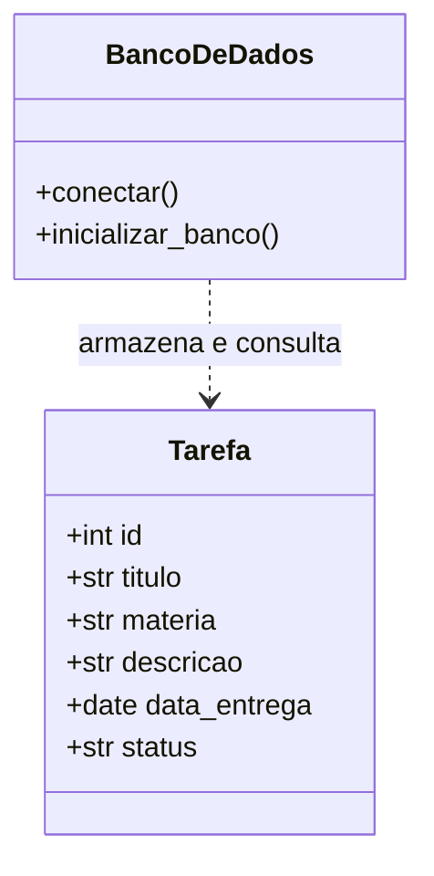

# Modelo UML — Organiza+

## Diagrama de classes

## Entidade e atributos

**Tarefa**
- `id`: identificador único (chave primária).
- `titulo`: nome da tarefa (obrigatório).
- `materia`: disciplina da tarefa (obrigatório).
- `descricao`: informações adicionais.
- `data_entrega`: data limite (obrigatório).
- `status`: Pendente ou Concluída.

## Relacionamentos e cardinalidade

Nesta primeira versão existe uma entidade principal (`Tarefa`), portanto não há relacionamento entre tabelas. Um registro representa uma tarefa escolar.

## Regras básicas
1. Toda tarefa precisa ter título, matéria e data de entrega.
2. O status começa como `Pendente`.
3. O status aceita somente `Pendente` ou `Concluída`.
4. Cada tarefa possui um `id` único.
